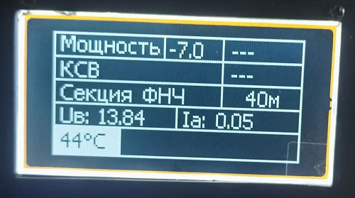
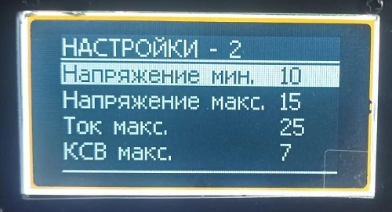
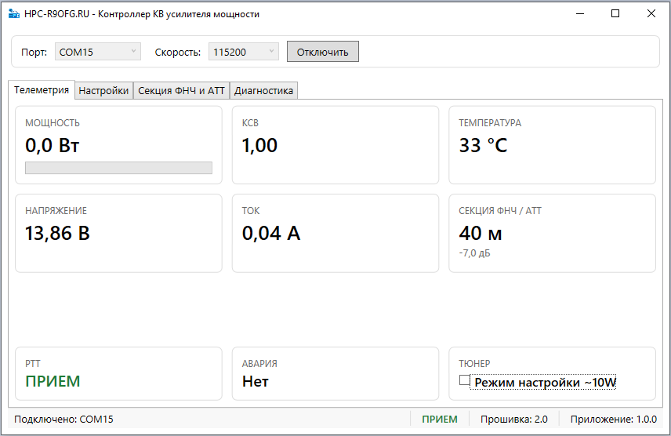

# HF_PA_Control_STM32F103C8T6

Контроллер HF-усилителя мощности на **STM32F103C8T6**: управление внешним
усилителем, 9-диапазонный ФНЧ, цифровой аттенюатор, защита, измерения,
графический дисплей и USB-интерфейс для управления с ПК.

Это именно контроллер: силовой части в проекте нет. Он управляет внешним
усилителем и измеряет параметры его питания и КСВ-моста.

В репозитории — описание проекта, скриншоты, назначение выводов, пределы
измерений и готовое приложение одним exe.

---

## Возможности

### Прошивка

- **Измерения**: выходная мощность, КСВ, напряжение питания, ток потребления,
  температура. Показания на дисплее сглаживаются, чтобы цифры не «мельтешили».
- **Защита**: минимальное/максимальное напряжение, максимальный ток,
  максимальный КСВ, перегрев, потеря датчиков I2C. При аварии питание УМ
  снимается, включается вентилятор, на дисплее выводится причина; после
  устранения — автоматическое восстановление.
- **ФНЧ на 9 диапазонов** (160, 80, 40, 30, 20, 17, 15, 12, 10 м):
  управление через SN74LS145, внешний код ABCD от трансивера или ручной выбор.
- **Цифровой аттенюатор PE4302**: 0…63 кода (шаг 0,5 дБ), индивидуальная
  настройка для каждого диапазона, хранение в эмуляции EEPROM во Flash.
- **Дисплей GMG12864-06D**: мощность, КСВ, диапазон, напряжение, ток,
  температура, «градусник» мощности, меню настроек, автоматическое отключение
  подсветки, управление кнопками.
- **USB CDC**: виртуальный COM-порт, ASCII-протокол — телеметрия, диагностика,
  настройки, управление ATT, диапазоном, PTT, вентилятором, `STATE`/`WORK`,
  `RESET`/`REBOOT`.
- **Служебное**: независимый watchdog (IWDG), обработка аварий, эмуляция EEPROM
  во внутренней Flash, плавное обновление показаний.

### Приложение

Windows-приложение на **WPF / .NET 8** для контроля и настройки усилителя.

- **Подключение**: автоматический поиск устройства по VID/PID и префиксу
  серийного номера `HPC`, выбор COM-порта, автопереподключение при потере связи.
- **Телеметрия**: мощность, КСВ, напряжение, ток, температура, диапазон,
  текущее затухание ATT, PTT, авария; анимация вентилятора.
- **Настройки**: чтение и запись параметров усилителя (подсветка, изменение
  мощности, управление ФНЧ, пороги защиты, температура вентилятора).
- **Секция ФНЧ и АТТ**: затухание по всем 9 диапазонам, профили ATT с
  пользовательскими именами, запись/чтение, автонастройка по максимуму
  выходной мощности.
- **Диагностика**: сырые коды АЦП, напряжения REF/FOR, мощности, пиковые
  значения за время передачи, состояние датчиков и вентилятора, проверка ключа
  вентилятора, перезагрузка STM32.
- **Режим настройки ~10 Вт**: старт с максимального затухания, плавный подъём
  мощности до ~10 Вт, запоминание подобранного ATT по диапазонам и возврат
  исходных значений после выключения режима.
- **Портативность**: один exe, настройки и профили хранятся рядом с ним.

---

## Пределы измерений

Контроллер измеряет параметры внешнего усилителя. Диапазоны ниже — это
аппаратные пределы контроллера, а не характеристики силовой части.

| Параметр | Диапазон | Разрешение | Ограничения |
|---|---|---|---|
| Напряжение питания | 0…36 В | 1,25 мВ (INA226) | вход INA226 не выше 36 В; пороги защиты по умолчанию 10…15 В |
| Ток потребления | ±81,9 А при шунте 1 мОм | 2,5 мА | практический предел — шунт и проводники; порог защиты по умолчанию 25 А |
| Мощность FOR | 0…~102 Вт | ~0,05 Вт в верхней части шкалы | 12-бит АЦП, шкала 3,2 В; зависит от делителя и калибровки моста |
| Мощность REF | 0…~109 Вт | ~0,05 Вт в верхней части шкалы | шкала 3,3 В; используется для расчёта КСВ |
| КСВ | 1,0…99,9 | — | только на передаче при FOR ≥ 1 Вт; ниже — «---», точность падает |
| Температура | −55…+125 °C | 0,5 °C | LM75A на плате/радиаторе контроллера, не температура кристалла выходных транзисторов |
| АЦП PA1…PA3 | 0…3,3 В | ~0,8 мВ | 12 бит; входы FOR/REF через делитель, не подавать больше 3,3 В |

Примечания:

- Пределы по мощности указаны для штатной калибровки `Kpwr = 500`,
  `LOAD_Z = 50`; при другом делителе или мосте шкала пересчитывается.
- INA226 работает с 16 усреднениями, период обновления ~35 мс; расчёт по АЦП —
  каждые 25 мс; дисплей обновляется ~100 мс, приложение опрашивает телеметрию
  каждые 500 мс.
- Пороги защиты — не пределы измерения: минимальное/максимальное напряжение,
  максимальный ток, КСВ и температура настраиваются. По умолчанию: 10/15 В,
  25 А, КСВ 7, 75 °C.
- Контроллер не является поверенным измерительным прибором. Реальная точность
  зависит от внешней силовой части, делителей КСВ-моста, шунта и калибровки.

---

## Скриншоты

### Дисплей

| Приём | Передача |
|---|---|
|  |  |
| **Меню настроек — 1** | **Меню настроек — 2** |
|  |  |

### Приложение

| Телеметрия, приём | Телеметрия, передача |
|---|---|
|  |  |
| **Настройки** | **Секция ФНЧ и АТТ** |
|  |  |
| **Диагностика** | |
|  | |

---

## Назначение выводов STM32F103C8T6

Питание — 3,3 В, тактирование — внешний кварц **HSE 8 МГц** (PLL ×9 = 72 МГц).

| Пин | Сигнал | Направление | Назначение |
|---|---|---|---|
| PA0 | `CONTROL_U` | выход | ключ питания УМ `+13.8V_OUT` (1 — включено) |
| PA1 | `ADC1_KEY` | вход АЦП | кнопки (резисторная лестница) |
| PA2 | `ADC1_REF` | вход АЦП | отражённая волна (REF) |
| PA3 | `ADC1_FOR` | вход АЦП | падающая волна (FOR) |
| PA4 | `FAN` | выход | вентилятор (1 — включён) |
| PA5 | `SPI1_SCK` | выход | тактирование дисплея |
| PA6 | `PTT_GND` | вход EXTI | внешний PTT |
| PA7 | `SPI1_MOSI` | выход | данные дисплея |
| PA8 | `PE_V1` | выход | PE4302, бит 0 — 0,5 дБ |
| PA9 | `PE_V2` | выход | PE4302, бит 1 — 1 дБ |
| PA10 | `PE_V3` | выход | PE4302, бит 2 — 2 дБ |
| PA11 | `USB_DM` | USB | USB CDC, D− |
| PA12 | `USB_DP` | USB | USB CDC, D+ |
| PA13 | `SWDIO` | отладка | SWD |
| PA14 | `SWCLK` | отладка | SWD |
| PA15 | `PTT_ON` | вход EXTI | внешний PTT |
| PB0 | `A_CODE` | выход | код ФНЧ, бит A |
| PB1 | `B_CODE` | выход | код ФНЧ, бит B |
| PB2 | `A_EXT` | вход | внешний код диапазона, бит A |
| PB3 | `C_CODE` | выход | код ФНЧ, бит C |
| PB4 | `D_CODE` | выход | код ФНЧ, бит D |
| PB5 | `PE_V4` | выход | PE4302, бит 3 — 4 дБ |
| PB6 | `I2C1_SCL` | I2C | INA226 / LM75A |
| PB7 | `I2C1_SDA` | I2C | INA226 / LM75A |
| PB8 | `PE_V5` | выход | PE4302, бит 4 — 8 дБ |
| PB9 | `PE_V6` | выход | PE4302, бит 5 — 16 дБ |
| PB10 | `LCD_CS` | выход | выбор дисплея |
| PB11 | `LCD_RST` | выход | сброс дисплея |
| PB12 | `LCD_DC` | выход | дисплей: данные/команда |
| PB13 | `LED_DISP` | выход | подсветка дисплея |
| PB14 | `C_EXT` | вход | внешний код диапазона, бит C |
| PB15 | `D_EXT` | вход | внешний код диапазона, бит D |
| PC13 | `LED_PTT` | выход | индикатор передачи |
| PC14 | `B_EXT` | вход | внешний код диапазона, бит B |
| PD0 / PD1 | `OSC_IN` / `OSC_OUT` | — | кварц HSE 8 МГц |

Служебные выводы: `NRST`, `BOOT0`, `VBAT`, `VDD`, `VSS`, `VDDA`, `VSSA`.

> В схеме v2.0 обозначения `ADC1_FOR`/`ADC1_REF` на PA2/PA3 исторически
> перепутаны. В прошивке и этой таблице указаны фактические сигналы:
> **PA2 — REF, PA3 — FOR**.

---

## Датчики и узлы

| Узел | Интерфейс | Адрес / выводы | Назначение |
|---|---|---|---|
| **INA226** | I2C1 | 0x40 | напряжение питания и ток, шунт 1 мОм |
| **LM75A** | I2C1 | 0x48 | температура радиатора/платы |
| **КСВ-мост** (TandemMatch) | АЦП | PA2 (REF), PA3 (FOR) | падающая и отражённая волна |
| **Кнопки** | АЦП | PA1 | резисторная лестница: F, <, > |
| **Вентилятор** | GPIO | PA4 | охлаждение, аварийный режим |
| **PE4302** | GPIO, 6 бит | PA8, PA9, PA10, PB5, PB8, PB9 | аттенюатор 0…31,5 дБ |
| **ФНЧ** | GPIO → SN74LS145 | PB0, PB1, PB3, PB4 | 9 диапазонов, 160–10 м |
| **PTT** | EXTI | PA6, PA15 | внешний сигнал передачи |

Мощность считается по напряжению с моста, КСВ — по отношению FOR/REF.
Защита использует мгновенные значения, а на дисплей и в приложение идут
сглаженные.

---

## Скачать и запустить

Готовое приложение — **один exe**, без установки:

**[Скачать HPC-R9OFG.exe](App/HPC-R9OFG.exe)**

- Windows 10/11, x64;
- .NET устанавливать не нужно (self-contained);
- настройки `HPC-R9OFG.ini` и профили `HPC-R9OFG.profiles.json` создаются
  рядом с exe, поэтому запускать лучше из обычной папки, а не из `Program Files`.

Для связи с усилителем нужен виртуальный COM-порт STM32 (USB CDC,
VID:PID `0483:5740`, серийный номер с префиксом `HPC`).

---

## Технологии

- **Микроконтроллер**: STM32F103C8T6, CMSIS/HAL, CMake + Ninja,
  `arm-none-eabi-gcc`, Release.
- **Прошивка**: C, USB CDC (Device FS), I2C, SPI, ADC + DMA, IWDG.
- **Приложение**: C# / WPF, .NET 8, `System.IO.Ports`, `System.Management`.
- **Публикация приложения**: self-contained single-file (`PublishSingleFile`).

---

Автор: **R9OFG**
